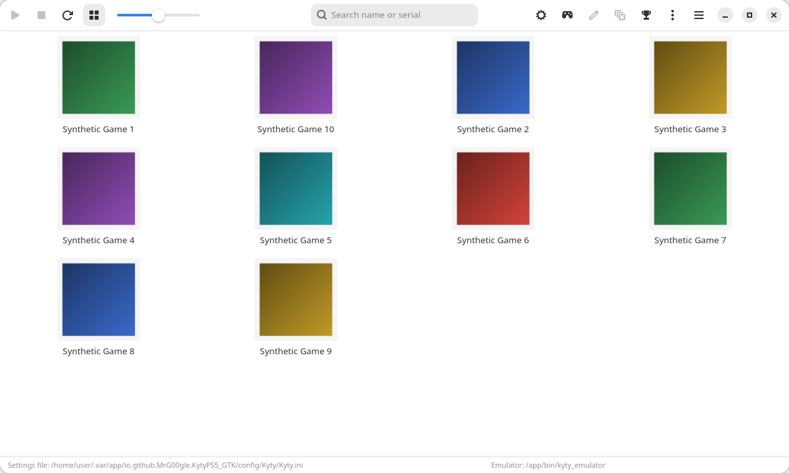

# KytyPS5-GTK

[](https://github.com/MrG00gle/KytyPS5-GTK/actions/workflows/build.yml?query=branch%3Amain)
[](https://github.com/MrG00gle/KytyPS5-GTK/actions/workflows/build.yml?query=branch%3Adev)
[](LICENSE)

KytyPS5-GTK is a fork of [upstream KytyPS5](https://github.com/KytyPS5/KytyPS5), a free and
open-source PlayStation 5 translation layer written in C++, which is based on
[Kyty](https://github.com/InoriRus/Kyty). The fork runs on Linux only, and it ships a GTK 4
launcher and a Flatpak package.

> [!IMPORTANT]
> KytyPS5-GTK is not affiliated with Sony Interactive Entertainment or PlayStation. The project
> does not distribute games or copyrighted system software. You must use only legally obtained
> game files.

## Fork changes

How KytyPS5-GTK differs from upstream KytyPS5:

- **Linux x86-64 only.** The fork builds, tests, and ships for Linux on x86-64 processors and for
  nothing else.
- **GTK launcher.** A GTK 4 and libadwaita launcher (`kyty_launcher`) replaces the Qt 6 launcher of
  upstream KytyPS5, with the same functions and a built-in log view instead of a host terminal.
- **Flatpak package.** The Flatpak `io.github.MrG00gle.KytyPS5_GTK` packages the launcher and the
  emulator, with sandbox-safe data locations. Each release attaches a `.flatpak` bundle.
- **No Windows support.** The Windows build, its CI job, and every Windows-only code path are gone
  (no MSVC, clang-cl, or winpthread).
- **No macOS support.** The macOS build, its CI job, the MoltenVK and Rosetta support, and the app
  bundle are gone.
- **No Nix or NixOS support.** The Nix flake, the Nix shells, and the NixOS build instructions are
  gone.
- **Coverage targets.** CI fails unless the tests cover at least 90 % of the lines and 95 % of the
  functions of the launcher core (`src/launcher/core`), 90 % of the lines of the Updater
  (`src/updater`), and 60 % of the lines of the GTK launcher code (`src/launcher/gtk`), and it fails
  when the overall line coverage drops more than 0.50 percentage points below the committed
  baseline.

## Project status

The emulator comes from upstream KytyPS5, which is in active development, so behavior can change
significantly between builds. Upstream KytyPS5 can boot 2D and 3D games, including titles built
with Unreal Engine 4/5, Unity, and custom engines. External low-level emulation modules are neither
required nor planned.

This fork adds the Linux packaging, the GTK launcher, tests, and CI on top of the upstream KytyPS5
emulator. Releases of the fork are published on the
[KytyPS5-GTK releases page](https://github.com/MrG00gle/KytyPS5-GTK/releases).

Community game test results are available in the
[upstream KytyPS5 compatibility list](https://kytyps5.github.io/), which the launcher also shows.
News about the emulator itself comes from the
[weekly updates of upstream KytyPS5](https://github.com/KytyPS5/KytyPS5/discussions/862) and the
[upstream KytyPS5 development Discord](https://discord.gg/UNrkMqGaBg).

Compatibility, stability, and performance can vary between versions, and you may encounter crashes
or graphical glitches. Report problems with this fork in the
[KytyPS5-GTK issue tracker](https://github.com/MrG00gle/KytyPS5-GTK/issues/new/choose) and include
the version you tested.

<p align="center">
  
</p>

<table align="center">
  <tr>
    <td align="center">
      <strong>Astro Bot</strong><br>
      
    </td>
    <td align="center">
      <strong>Saros</strong><br>
      
    </td>
  </tr>
  <tr>
    <td align="center">
      <strong>Neptunia ReVerse</strong><br>
      
    </td>
    <td align="center">
      <strong>SILENT HILL: The Short Message</strong><br>
      
    </td>
  </tr>
  <tr>
    <td align="center">
      <strong>Demon's Souls</strong><br>
      
    </td>
    <td align="center">
      <strong>UFC 6</strong><br>
      
    </td>
  </tr>
</table>

## System requirements

- The only supported platform is Linux on an x86-64 processor.
- A GPU with Vulkan 1.3 support is required, with a current driver. Update the graphics driver
  before you report rendering problems.
- The Flatpak needs Flatpak and the GNOME 49 runtime from Flathub, which `flatpak install` fetches.
- Building from source needs Clang, lld, CMake, and Ninja. The [building guide](docs/building.md)
  lists every package.

## Install with Flatpak

Download the `KytyPS5-GTK-<date>-<commit>-x86_64.flatpak` bundle of a release from the
[releases page](https://github.com/MrG00gle/KytyPS5-GTK/releases). Add the Flathub remote once,
so that Flatpak can install the runtime, then install the bundle and run it:

```bash
flatpak remote-add --user --if-not-exists flathub https://dl.flathub.org/repo/flathub.flatpakrepo
flatpak install --user ./KytyPS5-GTK-<date>-<commit>-x86_64.flatpak
flatpak run io.github.MrG00gle.KytyPS5_GTK
```

The desktop entry "KytyPS5-GTK" starts the same launcher. The Flatpak gets its updates through
Flatpak, not through the launcher's Updater. The [packaging guide](docs/packaging.md) explains the
updates, the sandbox permissions, and how to give the Flatpak access to more folders.

## Building from source

Install the packages that the [building guide](docs/building.md) lists for your distribution, then
build and install with Clang and lld:

```bash
git clone --recursive https://github.com/MrG00gle/KytyPS5-GTK.git
cd KytyPS5-GTK
cmake -S . -B _Build/linux -G Ninja -DCMAKE_BUILD_TYPE=Release \
  -DCMAKE_C_COMPILER=clang -DCMAKE_CXX_COMPILER=clang++
cmake --build _Build/linux
cmake --install _Build/linux --prefix _Build/linux/install
```

`_Build/linux/install` then holds `kyty_launcher`, `kyty_emulator`, and `kyty_updater`. The
[testing guide](docs/testing.md) shows how to build and run the tests and the coverage report.

## Running

Start the launcher, add the folders that hold your games, select a game, and run it:

```bash
./_Build/linux/install/kyty_launcher
```

The launcher finds game directories that contain `eboot.bin` and ZArchive (`.zar`) files whose
archive root contains `eboot.bin`. It shows the emulator's output in its log view. The emulator can
also run a legally obtained game directly:

```bash
./_Build/linux/install/kyty_emulator --game "/games/ExampleGame"
./_Build/linux/install/kyty_emulator --game "/games/ExampleGame.zar"
```

The [running guide](docs/running.md) covers the first launch, game folders, ZArchive games, the log
view, the release archive, the Updater, and every emulator option.

## Documentation

- [Building](docs/building.md): dependencies, configure, build, and install.
- [Running](docs/running.md): the launcher, the log view, and every emulator option.
- [Configuration](docs/configuration.md): every global setting and where the settings are stored.
- [Architecture](docs/architecture.md): the source tree, the process model, and the data folder.
- [Testing](docs/testing.md): the test suite, coverage, CI, and the manual checklist.
- [Packaging](docs/packaging.md): the Flatpak build, its permissions, and its updates.
- [Notification localization](docs/notification-localization.md): the trophy notification texts.
- [Contributing](CONTRIBUTING.md): branches, checks, formatting, coverage rules, and AI use.

## Contributing

Testing games and submitting detailed bug reports are useful ways to contribute. Search the
[existing issues](https://github.com/MrG00gle/KytyPS5-GTK/issues) first, then use the
**Game Emulation Status Report** template and attach the complete log.

Pull requests target the `dev` branch, and every CI check must pass. [CONTRIBUTING.md](CONTRIBUTING.md)
has the branch rules, the clang-format hook, the coverage rules, and the AI use policy.

## License

KytyPS5-GTK is licensed under the [GNU General Public License version 2](LICENSE), SPDX identifier
`GPL-2.0-only`.

This project is based on the original [Kyty](https://github.com/InoriRus/Kyty), which was released
under the MIT License. Kyty's original copyright and license notice are preserved in
[`LICENSES/Kyty-MIT.txt`](LICENSES/Kyty-MIT.txt). Third-party components remain subject to their own
licenses, which are included with those components.

## Acknowledgments

- [Upstream KytyPS5](https://github.com/KytyPS5/KytyPS5): the emulator that this fork packages and
  extends.
- [Kyty](https://github.com/InoriRus/Kyty): upstream KytyPS5 is based on a heavily modified version
  of the original Kyty project.
- [shadPS4](https://github.com/shadps4-emu/shadPS4): a reference for understanding PS4 memory
  behavior, GPU resource aliasing, cache coherency, and the AVPlayer implementation.
